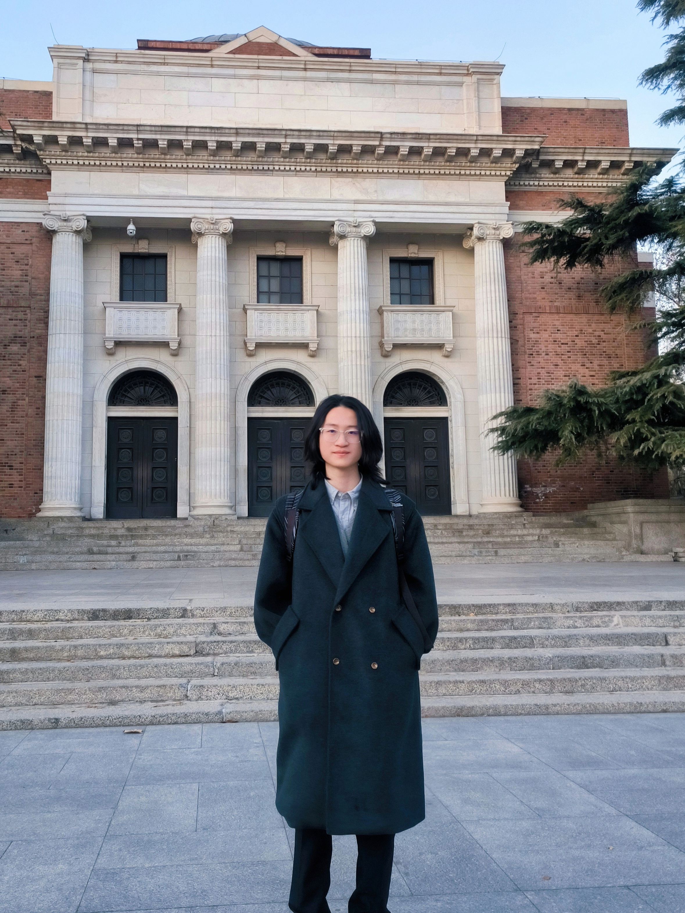

<h1>Hi, I'm Haopeng Deng.</h1>

  
  
  
  

---

<table border="0" style="border-collapse: collapse; border: none; width: 100%;">
  <tr style="border: none;">
    <td width="70%" valign="middle" style="border: none; padding-right: 15px;">
      <ul>
        <li>I study traffic dynamics and mixed-autonomy systems, especially how local interactions shape collective traffic behavior.</li>
        <li>Here I share research code and experiments on traffic phase inference, calibration, and spatiotemporal data recovery.</li>
        <li>For my publications, research experience, and current interests, visit my <a href="https://qianyhp.github.io/">academic homepage</a>. Always open to research discussions and collaborations.</li>
      </ul>
    </td>
    <td width="30%" valign="middle" style="border: none; text-align: center;">
      <picture>
        <source srcset="profile.webp">
        
      </picture>
    </td>
  </tr>
</table>

---

